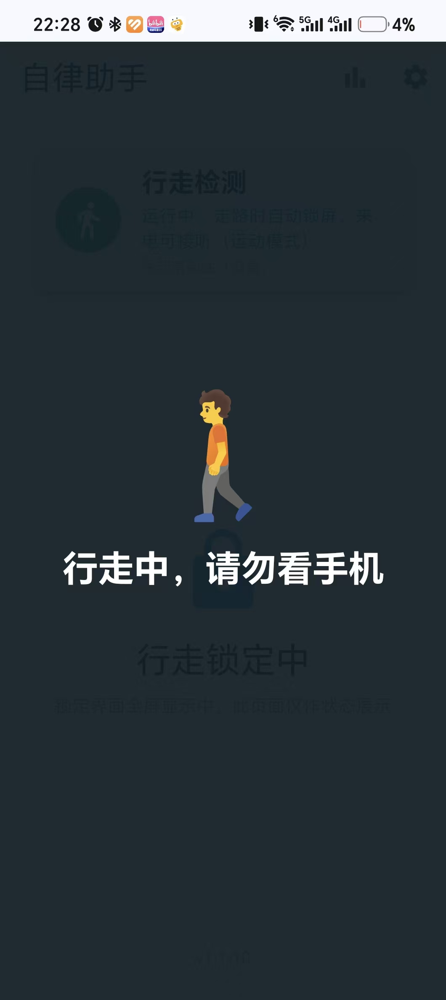
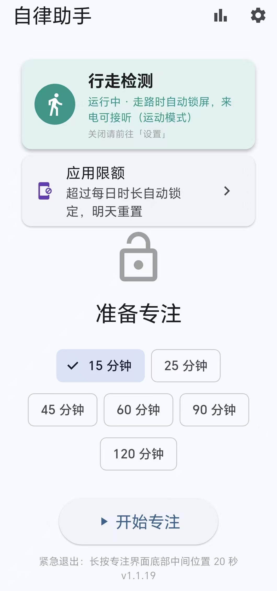
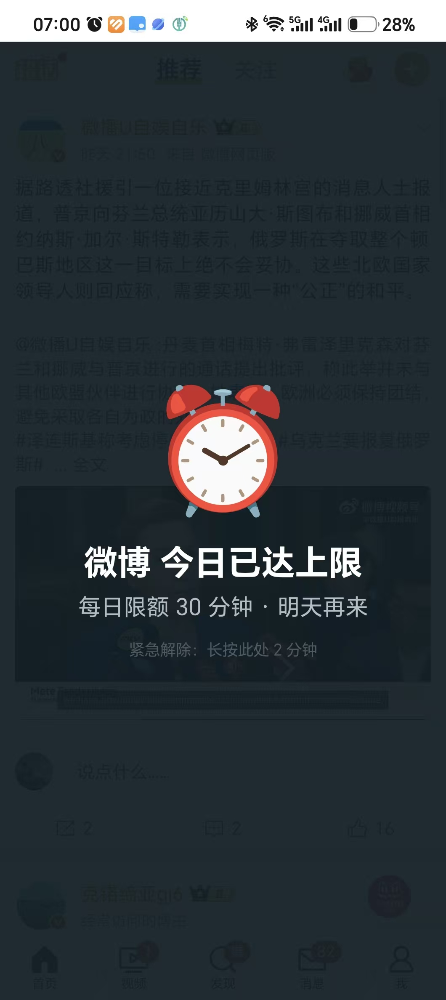

# Self-Discipline (自律助手)

> [中文文档](README.md)

An Android app that helps you focus on study/work and put your phone down while walking.

**Free · No ads · All data stays on device · No user tracking**

> License note: This project is licensed under [PolyForm Noncommercial 1.0.0](LICENSE) + an additional permission —
> free to use, modify, and redistribute; vendors may **bundle it for free**; but **no charging and no ads**.
> Technically this makes it "source available" rather than OSI open source —
> a deliberate choice to keep the app free and ad-free forever.

## Screenshots

| Home | Focus Lock | Walking Guard | App Limit |
|---|---|---|---|
|  |  |  |  |

## Features

### 1. Focus Lock
- One-tap focus sessions (15/25/45/60/90/120 min)
- Fullscreen lock page; switching to other apps pulls you back (accessibility service)
- Lock state persists natively — survives process kills and reboots
- Emergency exit: long-press bottom-center of the lock page for 20s (counted as a failure)
- **Calls still work** during any lock (dialer/in-call UI whitelisted, incl. Samsung)
- Screen-off allowed to save battery; the lock page returns when you wake the phone

### 2. Walking Detection (on by default)
- Detects walking via the hardware step detector, with a variance+periodicity fallback
- Anti-flicker hysteresis: locks after 5s of walking, releases 2.5s after you stop
- Charging-safe: suppressed while charging (charger noise protection)
- **Calls exempt**: incoming/ongoing calls never trigger the walking lock
- Music started while stationary keeps playing
- Three sensitivity levels
- Accessibility overlay covers any app (maps included) — unaffected by Android 10+ background-activity restrictions
- Five-layer service survival: foreground service + START_STICKY + boot restore + accessibility watchdog (2min) + AlarmManager watchdog (15min, immune to OEM auto-start management)

### 3. Daily App Limits
- Set a daily usage cap (10–120 min) for ANY installed launcher app (searchable picker)
- When the cap is hit, an accessibility overlay covers the app ("See you tomorrow")
- Screen-off time doesn't count; resets daily at midnight
- Emergency release: hold bottom-center for **2 minutes** (deliberately costly)

### 4. Stats
- Total focus time, consecutive days, success/failure counts, walking interventions
- 100% local storage; uninstalling erases everything

## How It Works (honest capability notes)

| Capability | Implementation | Boundary |
|---|---|---|
| Blocking app switching | Accessibility service watches foreground windows; non-whitelisted apps get pulled back | You can disable the service in system settings (self-discipline tool, not enforcement) |
| Emergency exit | Long-press hidden/visible zone at bottom-center (1s walking / 20s focus / 2min limits) | Focus exits recorded as failures |
| Uninstall protection | Device admin (optional) | Can be deactivated in-app: Settings → Uninstall |
| Walking detection | Step detector + accelerometer variance/periodicity | Car rides may misfire on variance fallback (lower sensitivity) |
| Call exemption | Call state listener + dialer package whitelist | OEM-specific call UI package names may vary — issues welcome |

## Install

1. Download the APK from [Releases](https://github.com/cosmichut/self-discipline/releases)
2. Allow "install from unknown sources"
3. On first launch, follow the guide to enable the **Accessibility Service** (required)

### Auto-updates via Obtainium (recommended)

Install [Obtainium](https://github.com/ImranR98/Obtainium) (open-source app update tracker) and add `https://github.com/cosmichut/self-discipline` as a source to get automatic update notifications for future releases.

> Note: F-Droid/IzzyOnDroid inclusion is unlikely because the PolyForm Noncommercial license (by design) is not OSI/FSF-approved. GitHub Releases + Obtainium is the intended distribution path.

### Accessibility toggle greyed out?

Apps installed outside an app store are restricted on stock Android 13+ / Samsung / Honor / Xiaomi. Lift the restriction first:

- **Stock/Samsung**: Settings → Apps → Self-Discipline → ⋮ menu (top right) → **Allow restricted settings**
- **Honor**: Settings → Apps → App management → Self-Discipline → **Remove restriction**
- **Xiaomi**: Settings → Apps → Manage apps → Self-Discipline → **Allow restricted settings**

The in-app permission guide shows the same instructions.

## Build from Source

### Docker (recommended, no local toolchain needed)

```bash
bash docker_image_build.sh   # build the flutter-env:ok image (once, ~10-20 min)
bash docker_build.sh         # build the APK
```

Artifacts: `flutter_app/build/app/outputs/flutter-apk/app-release.apk` and `self-discipline.apk` (copied to repo root).

### Local

```bash
cd flutter_app
flutter pub get
flutter build apk --release
```

### Tests

```bash
cd flutter_app && flutter test
```

## Permissions (minimal)

| Permission | Purpose | Required |
|---|---|---|
| Accessibility service | Block app switching during locks (**never reads screen content**, `canRetrieveWindowContent=false`) | Core |
| Foreground service + notifications | Walking detection | Walking feature |
| READ_PHONE_STATE | Call exemption (call state only, never the number) | Recommended |
| WAKE_LOCK | Sensor sampling with screen off | Walking feature |
| RECEIVE_BOOT_COMPLETED | Restore detection/locks after reboot | Recommended |
| Ignore battery optimizations | Keep the detection service alive | Recommended |
| Device admin | Uninstall protection only | Optional |

The app picker for limits uses a `<queries>` launcher-intent declaration (official exemption) — **no QUERY_ALL_PACKAGES** permission.

**Not requested**: network, location, storage, contacts — nothing unrelated to functionality.

**No INTERNET permission at all** — data physically cannot leave your device.

## Tech Stack

- Flutter 3.x (Dart) + Kotlin (native layer)
- Lock/stats state persisted natively in SharedPreferences (survives Flutter engine death)
- MethodChannel/EventChannel bridge
- minSdk 24 / targetSdk 35

## Contributing

Issues and PRs welcome — see [CONTRIBUTING.md](CONTRIBUTING.md).

## License

[PolyForm Noncommercial License 1.0.0](LICENSE) + additional permission (free bundling allowed; charging and ads prohibited).
Copyright (c) 2026 Self-Discipline Project Contributors.
